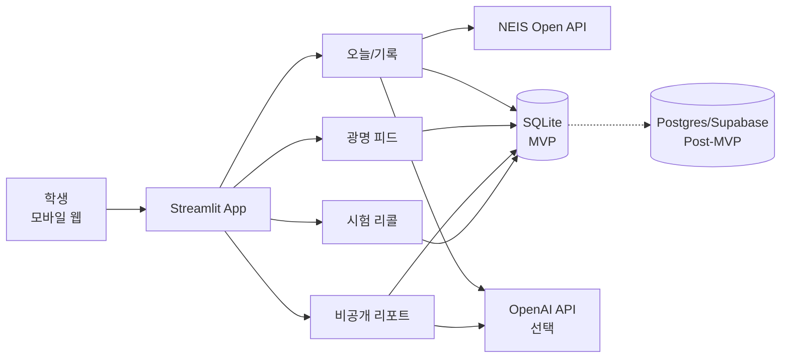

# PRD: 한줄 (hanjul)

> **오늘 배운 한 줄, 광명의 배움 피드.**

| 항목 | 내용 |
|---|---|
| 문서명 | 한줄(hanjul) 제품 요구사항 문서 (PRD) |
| 버전 | v1.0 |
| 상태 | Draft → Hackathon Approved |
| 작성자 | ax1s-x1zz (1인 개발) |
| 검토자 | 해커톤 팀 / 심사위원 (TBD) |
| 작성일 | 2026-11-07 |
| 최종 수정일 | 2026-11-07 |
| 관련 문서 | [README.md](./README.md), `.env.example` |
| 제출 맥락 | 2026 지역연합 해커톤 |
| 공개 범위 | Public repository |

**문서 작성 기준**: Aha! PRD Template(제품·릴리스·에픽·기능 요구사항 계층), Google PRD Template(Overview → Goals & Success Metrics → User Stories → Features & Requirements → Design & UX → Technical Specs → Timeline → Risks → Appendix), Docsio PRD Guide 2026(Status/Author/Reviewers, Problem, Scope, Functional Requirements, Success Metrics, Timeline)를 종합했다.

### 변경 이력

| 버전 | 날짜 | 작성자 | 변경 내용 |
|---|---|---|---|
| v0.1 | 2026-11-07 | ax1s-x1zz | 아이디어 정리 및 범위 확정 |
| v9.9 | 2026-11-07 | ax1s-x1zz | 해커톤 범위(광명시) 및 기능 확정 |
| v1.0 | 2026-11-07 | ax1s-x1zz | 전문 PRD 양식으로 재작성 |

---

## 0. 한 페이지 요약 (Executive Summary)

**한줄(hanjul)** 은 고등학생이 **수업 직후 10초**로 “오늘 배운 한 줄”을 남기는 학습 기록 SNS다.

- **시간표는 학교가 채운다.** NEIS 시간표 API가 오늘의 교시·과목을 자동으로 불러온다.
- **기록은 학생이 채운다.** 학생은 배운 것 한 줄, 활동 태그, 막힌 개념만 남긴다.
- **상세는 나만 본다.** 주간 리포트·막힘 분석·시험 리콜은 비공개다.
- **한 줄은 선택해서 공유한다.** 공개를 켠 글만 **경기 광명시** 학생 피드에 올라간다.
- **지역은 데이터로 말한다.** 익명 집계로 “오늘 광명에서 가장 많이 막힌 개념”을 보여준다.

> **핵심 문장**: “인스타에는 노는 것이 올라간다. 배운 것은 여기에 올린다.”

**해커톤 데모 목표**: 진성고등학교 2학년 5반 시간표를 불러와, 기록 → 공개 → 피드 → 비공개 리포트 → 지역 막힘 TOP → 시험 리콜까지 **3분 안에 끊김 없이 시연**한다.

---

## 1. 배경 및 문제 정의

### 1.1 현재 학생의 일상

| 시간 | 행동 | 결과 |
|---|---|---|
| 등하교·쉬는 시간 | 인스타 스토리·릴스, 유튜브 쇼츠 | 짧은 소비, 기억에 남지 않음 |
| 수업 중 | 딴짓 또는 다른 과목 숙제 | 수업 내용이 기록되지 않음 |
| 방과 후 | 다시 릴스·게임 | 학습 맥락 단절 |
| 시험 2주 전 | 벼락치기 | “내가 뭘 모르는지” 모른 채 시작 |

### 1.2 문제

1. **소비형 숏폼은 기억을 남기지 않는다.** 학생의 주의는 이미 “짧은 피드”에 최적화되어 있다.
2. **학습 기록은 사적이고 구조화되지 않는다.** 노트는 쌓이지만 “내가 어디서 막혔는지”는 남지 않는다.
3. **공유는 왜곡되어 있다.** 공부를 인스타에 올리면 성적 자랑·공부 인증이 되기 쉽고, 대다수 학생은 부담을 느낀다.
4. **학교 시스템은 관리 도구다.** 클래스팅·하이클래스는 알림·관리 중심이며, 학생의 자기 표현과 축적을 다루지 않는다.

### 1.3 기존 대안과 한계

| 대안 | 강점 | 한계 |
|---|---|---|
| Instagram / YouTube | 몰입도, 습관 | 학습 기록·회고 없음, 소비 중심 |
| 클래스팅 / 하이클래스 | 학교 공지·관리 | 학생 주도 기록·공유 없음 |
| Notion / 굿노트 | 자유로운 기록 | 입력 부담 큼, 사회적 피드백 없음 |
| 학교알리미 | 공식 정보 | 개인 기록·일상 기록 없음 |
| **한줄** | **자동 채움 + 10초 + 선택 공개 + 지역 집계** | 초기 콘텐츠·모더레이션 필요 |

### 1.4 기회

- **NEIS 오픈API**로 시간표·학사일정을 무료로 가져올 수 있다.
- **LLM**으로 개념 태그·주간 요약·질문 카드 생성 비용이 낮아졌다.
- **지역 단위**로 좁히면 콜드 스타트·모더레이션·개인정보 문제를 통제할 수 있다.

### 1.5 문제 정의문 (How Might We)

> **HMW**: “학생이 수업 직후 10초로 배움을 남기고, 그 기록이 시험 전에 자신에게 돌아오며, 원할 때만 같은 지역 친구들과 나눌 수 있게 하려면 어떻게 해야 하는가?”

---

## 2. 목표와 성공 지표

### 2.1 제품 목표

| 목표 | 설명 |
|---|---|
| G1. 기록 습관 | 수업 직후 10초 기록을 일상 루틴으로 만든다 |
| G2. 메타인지 | “내가 무엇을 모르는지”를 시험 전에 알게 한다 |
| G3. 건강한 공유 | 성적 자랑이 아닌 **과정 공유** 문화를 만든다 |
| G4. 지역 인사이트 | 광명시 학생들의 막힘을 익명 집계로 보여준다 |
| G5. 데이터 활용 증명 | NEIS 데이터가 실제 제품 가치로 이어짐을 증명한다 |

### 2.2 비목표 (Non-goals)

- 전국 서비스, 중학생 대상, 교사용 대시보드, 학부모 앱은 **이번 릴리스에서 만들지 않는다.**
- 성적·등수·랭킹·팔로워 수를 만들지 않는다.
- 사진·영상·DM·실명 인증을 만들지 않는다.

### 2.3 성공 지표 (KPI)

| 구분 | 지표 | 정의 | 목표(가정) | 측정 |
|---|---|---|---|---|
| North Star | WLP | 주간 활동 학생 1인당 기록한 수업 수 | ≥ 8 | `log_save` 집계 |
| Activation | 첫 기록 완료율 | 시간표 연동 후 24시간 내 1건 이상 기록 | ≥ 70% | 퍼널 |
| Engagement | D1 리텐션 | 다음 날 재방문 | ≥ 50% | 세션 |
| Engagement | D7 리텐션 | 7일 후 재방문 | ≥ 30% | 세션 |
| Sharing | 공개 전환율 | 기록 중 공개 선택 비율 | 15–25% | `post_publish`/`log_save` |
| Report | 주간 리포트 열람률 | 활동 학생 중 리포트 열람 | ≥ 50% | `report_view` |
| Learning | 리콜 완료율 | 시험 2주 전 리콜 카드 완료 | ≥ 40% | `recall_complete` |
| Safety | 신고 처리 | 24시간 내 검토 | 100% | 운영 로그 |
| Safety | PII 노출 | 공개 글 개인정보 노출 건수 | 0 | 감사 |
| Performance | 페이지 응답 | p95 | < 2초 | 계측 |
| Performance | AI 응답 | p95 | < 5초 | 계측 |
| Demo | 데모 성공 | 3분 시나리오 무오류 | 100% | 리허설 |

> 목표 수치는 해커톤 가설이며, 실사용 데이터가 쌓이면 재설정한다.

### 2.4 해커톤 데모 성공 기준

1. 진성고 2학년 5반 시간표가 자동 표시된다.
2. 5교시 기록을 10초 안에 저장한다.
3. 공개 토글을 켜면 광명시 피드에 카드가 나타난다.
4. 다른 계정으로 응원할 수 있다.
5. 비공개 리포트에서 막힘 TOP 3가 보인다.
6. 지역 막힘 TOP에서 익명 집계가 보인다.
7. 시험 D-day 리콜 카드가 뜬다.

---

## 3. 사용자

### 3.1 주요 사용자

| 구분 | 정의 | 규모(가정) |
|---|---|---|
| Primary | 경기 광명시 고등학생 1–3학년 | 데모: 진성고 2학년 5반 |
| Secondary | 같은 지역 고등학생 (피드 소비) | 광명시 고등학생 |
| Future | 교사(학급 막힘 파악), 학부모(리포트 공유) | Post-MVP |

### 3.2 페르소나

**P1. 김하늘 (고2, 광명)**
- 하루 1시간 이상 릴스·쇼츠를 본다.
- 시험 2주 전에야 공부를 시작하고, 늘 “뭘 모르는지” 모른 채 시작한다.
- 기록 앱을 여러 번 시도했지만 3일을 못 넘겼다.
- **니즈**: 입력이 귀찮지 않은 기록, 시험 전에 내 약점을 보여주는 것.

**P2. 이준 (고1, 광명)**
- 공부를 잘하는 편은 아니고, 공부 인증을 올리는 것은 부담스럽다.
- 틀린 문제나 막힌 개념을 익명으로 공유하고 싶다.
- **니즈**: 자랑 없이 과정을 나누는 공간, 같은 처지의 친구.

**P3. 박지연 (진성고 교사, Secondary/Future)**
- 수업 후 학생들이 어디서 막혔는지 알기 어렵다.
- **니즈**: 학급 단위의 익명 막힘 요약 (Post-MVP).

### 3.3 Jobs To Be Done

| 상황 | JTBD |
|---|---|
| 수업 직후 | “10초 안에 오늘 배운 것을 남기고 싶다” |
| 시험 전 | “내가 뭘 모르는지 빨리 알고 싶다” |
| 공유하고 싶을 때 | “공부하는 나를 부담 없이 보여주고 싶다” |
| 지역이 궁금할 때 | “같은 지역 친구들이 어디서 막히는지 알고 싶다” |

### 3.4 사용자 여정

| 단계 | As-Is | To-Be |
|---|---|---|
| 수업 후 | 아무것도 남기지 않음 | 시간표 카드 → 10초 기록 |
| 공유 | 인스타에 일상만 | 선택한 한 줄만 광명 피드 |
| 시험 전 | 막막함 | 주간 리포트 + 시험 리콜 |
| 회고 | 없음 | 개념 타임라인 |

---

## 4. 가치 제안 및 차별점

### 4.1 가치 제안

> **“시간표가 자동으로 채워주는 10초 기록. 상세는 나만, 한 줄은 광명시 전체와. 시험 전엔 내 막힘만 모아 복습.”**

### 4.2 차별점

| 차별점 | 설명 | 방어력 |
|---|---|---|
| 자동 채움 | NEIS 시간표로 입력 부담 제거 | 학교 데이터 연동 |
| 선택 공개 | 기본 비공개, 공개는 명시적 opt-in | 프라이버시 신뢰 |
| 지역 단위 | 광명시로 좁혀 콜드 스타트·안전 확보 | 운영 가능성 |
| 과정 공유 | 성적·등수 없음, 막힘도 공유 가능 | 문화 적합성 |
| 시험 리콜 | 기록이 시험 전 복습으로 순환 | 재방문 동기 |

### 4.3 포지셔닝 맵 (텍스트)

```
            사회적 공유 ↑
                      │
       Instagram      │      한줄
       (일상/소비)     │   (배움/과정)
                      │
  소비 중심 ──────────┼────────── 축적 중심
                      │
       YouTube        │      Notion
       (콘텐츠 소비)   │   (개인 기록)
                      │
            개인 기록 ↓
```

---

## 5. 범위

### 5.1 In Scope (이번 릴리스)

- 경기 광명시 고등학생
- 데모 학교: 진성고등학교 (J10 / 7530207)
- NEIS 시간표·학사일정 연동
- 10초 기록(한 줄 + 활동 태그 + 막힘)
- 공개 토글 + 광명시 피드 + 응원
- 비공개 주간 리포트(막힘 TOP 3, 과목 분포)
- 지역 막힘 TOP(익명 집계, k≥5)
- 시험 D-day 리콜(SM-2)
- 익명 프로필(자동 닉네임)
- 신고·숨김·금칙어 필터
- 데이터 내보내기/삭제

### 5.2 Out of Scope (Won't)

- 전국 피드, 타 지역
- 중학생(만 14세 미만) 가입
- 사진·영상 업로드
- DM, 팔로우, 팔로워 수
- 성적·등수·랭킹·리더보드
- 교사 대시보드, 학부모 앱
- 푸시 알림, 실시간 채팅
- 결제, 광고
- 실명/학교 인증
- 공개 글에 학교명 노출

### 5.3 가정

- 학생은 스마트폰 웹 브라우저로 접속한다.
- NEIS API가 학급 시간표를 제공한다.
- 하루 6–7교시가 기록 대상이다.
- 해커톤 기간 내 1개 학교·1개 반 데모가 가능하다.
- OpenAI API 키와 사용 쿼터가 확보된다.

### 5.4 제약

- Streamlit은 실시간 피드·무한 스크롤·강한 인증에 한계가 있다.
- SQLite는 동시 쓰기에 한계가 있다(데모 한정).
- NEIS `ITRT_CNTNT`는 과목명이 아니라 행사명일 수 있다.
- 미성년자 개인정보·모더레이션 제약이 있다.
- 해커톤 시간이 짧다.

### 5.5 MoSCoW 요약

| 우선순위 | 기능 |
|---|---|
| **Must** | 시간표 자동, 10초 기록, 공개 토글, 피드, 익명, 비공개 리포트 |
| **Should** | 지역 막힘 TOP, 시험 리콜, 응원, 신고 |
| **Could** | AI 개념 태그, 주간 요약, 질문 카드, 데이터 내보내기 |
| **Won't** | 전국, 사진, DM, 랭킹, 교사 대시보드 |

---

## 6. 사용자 스토리

| ID | 사용자 스토리 | 우선순위 | 연결 FR |
|---|---|---|---|
| US-01 | 학생으로서, 시간표가 자동으로 채워져서 10초 안에 기록하고 싶다 | Must | FR-02, FR-03 |
| US-02 | 학생으로서, 내 기록은 기본적으로 나만 보고 싶다 | Must | FR-04, FR-07 |
| US-03 | 학생으로서, 원하는 글만 광명시 친구들에게 공개하고 싶다 | Must | FR-04, FR-05 |
| US-04 | 학생으로서, 친구의 배움 글에 부담 없이 응원하고 싶다 | Should | FR-06 |
| US-05 | 학생으로서, 이번 주 내가 어디서 막혔는지 알고 싶다 | Must | FR-07 |
| US-06 | 학생으로서, 시험 전에 내 막힌 개념만 복습하고 싶다 | Should | FR-09 |
| US-07 | 학생으로서, 같은 지역 친구들이 어디서 막히는지 궁금하다 | Should | FR-08 |
| US-08 | 학생으로서, 실명 없이 안전하게 활동하고 싶다 | Must | FR-11, FR-10 |
| US-09 | 학생으로서, 불쾌한 글을 신고하고 숨기고 싶다 | Must | FR-10 |
| US-10 | 학생으로서, 내 데이터를 내보내거나 삭제하고 싶다 | Could | FR-12 |
| US-11 | 학생으로서, AI가 내 기록을 정리해주면 좋겠다 | Could | FR-13 |
| US-12 | 운영자로서, 데모용 시드 콘텐츠를 넣고 싶다 | Should | FR-14 |

---

## 7. 기능 요구사항

### 7.1 기능 목록

| ID | 기능 | 우선순위 | 화면 |
|---|---|---|---|
| FR-01 | 온보딩·학교/학급 설정 | Must | S-01 |
| FR-02 | 시간표 자동 조회·캐시·보정 | Must | S-02 |
| FR-03 | 10초 기록 작성 | Must | S-03 |
| FR-04 | 공개 전환·살균 | Must | S-03 |
| FR-05 | 광명시 피드 | Must | S-04 |
| FR-06 | 응원 | Should | S-04 |
| FR-07 | 비공개 주간 리포트 | Must | S-05 |
| FR-08 | 지역 막힘 TOP | Should | S-05 |
| FR-09 | 시험 D-day 리콜 | Should | S-06 |
| FR-10 | 안전·신고·모더레이션 | Must | S-04, S-07 |
| FR-11 | 익명 프로필 | Must | S-01, S-07 |
| FR-12 | 데이터 내보내기·삭제 | Could | S-07 |
| FR-13 | AI 보조(태그·요약·질문) | Could | S-03, S-05 |
| FR-14 | 운영 시드·관리자 | Should | S-07 |
| FR-15 | 오류·오프라인 fallback | Must | 전체 |

### 7.2 상세 요구사항

#### FR-01. 온보딩·학교/학급 설정 (Must)

- **설명**: 사용자는 학교·학년·반을 선택하고, 자동 생성된 익명 닉네임을 받는다.
- **수용 기준**
  - Given 광명시 학교 목록, When 학교를 검색하면, Then 진성고등학교가 선택된다.
  - Given 학년/반 선택, When 저장하면, Then 세션에 학교·학년·반이 유지된다.
  - Given 저장 완료, When 다음 접속, Then 재입력 없이 오늘 화면으로 진입한다.
- **예외**: 학교를 찾지 못하면 수동 코드 입력(교육청 코드+학교 코드) 제공.
- **개인정보**: 실명·전화번호·주소는 수집하지 않는다.

#### FR-02. 시간표 자동 조회·캐시·보정 (Must)

- **설명**: 오늘 날짜의 학급 시간표를 NEIS에서 조회해 교시별 카드로 표시한다.
- **수용 기준**
  - Given 학교/학년/반/날짜, When 오늘 화면 로드, Then 교시·과목이 표시된다.
  - Given 동일 날짜 재접속, When 24시간 내, Then 캐시를 사용한다.
  - Given API 실패, When 2회 재시도 후 실패, Then 수동 입력 카드와 재시도 버튼을 보여준다.
  - Given `ITRT_CNTNT`가 행사명(“숙박형 현장체험학습”) 또는 공백, When 표시, Then “수업 정보 없음”으로 표시하고 과목 수동 입력을 허용한다.
- **캐시 키**: `(school_code, date, grade, class_no)`.
- **정규화**: `수학Ⅱ→수학2`, `화학Ⅰ→화학1` 등 매핑 테이블 적용.

#### FR-03. 10초 기록 작성 (Must)

- **설명**: 교시별로 배운 것 한 줄, 활동 태그, 막힌 개념을 저장한다.
- **입력**
  - 필수: `learned` (1–120자)
  - 선택: `activity` ∈ {들음, 필기, 문제풀이, 질문, 이해못함}
  - 선택: `stuck` (0–80자)
- **수용 기준**
  - Given 빈 기록, When 저장, Then 1건이 생성되고 화면에 “기록됨” 표시가 된다.
  - Given 120자 초과, When 저장, Then 저장되지 않고 글자 수 오류를 보여준다.
  - Given 동일 교시 중복 저장, When 저장, Then 기존 기록을 수정한다(upsert).
  - Given 저장 성공, When 3초 이내, Then 다음 교시 카드로 포커스가 이동한다.
- **성능**: 저장 p95 < 1초 (로컬 기준).

#### FR-04. 공개 전환·살균 (Must)

- **설명**: 기록 저장 시 공개 여부를 선택한다. 기본값은 **비공개**다.
- **수용 기준**
  - Given 비공개 기록, When 아무 동작 없음, Then 피드에 노출되지 않는다.
  - Given 공개 토글 ON, When 게시, Then 살균된 사본이 `posts`에 생성된다.
  - Given 공개 글, When 미리보기, Then 학교명·실명·전화번호·이메일·URL이 마스킹되어 있다.
  - Given 살균 실패, When 게시, Then 게시를 차단하고 수정을 요청한다.
- **살균 규칙**
  - 학교명, 교사명, 전화번호, 이메일, URL, 주민등록번호 패턴 제거
  - 6자리 이상 연속 숫자 마스킹(학번·전화번호 오인 방지)
  - 원문(`logs.learned`)은 절대 공개 테이블로 복사하지 않는다.

#### FR-05. 광명시 피드 (Must)

- **설명**: 공개 글을 최신순 + 무작위 탐색으로 보여준다.
- **수용 기준**
  - Given 공개 글 1건, When 피드 로드, Then 카드가 표시된다.
  - Given 과목 필터, When 선택, Then 해당 과목 글만 표시된다.
  - Given 20건 초과, When “더 보기”, Then 다음 페이지가 로드된다.
  - Given 신고 누적 3회, When 피드 로드, Then 해당 글은 숨김 처리된다.
- **정렬**: `score = recency + subject_match + random(0.1–0.2)`. 좋아요 총합 정렬 금지.
- **노출 정보**: 닉네임, 학년, 계열, 과목, 교시, 공개 글, 응원 수. 학교명 없음.

#### FR-06. 응원 (Should)

- **설명**: 글에 1회 응원할 수 있다.
- **수용 기준**
  - Given 글, When 응원, Then 카운트가 1 증가한다.
  - Given 동일 사용자 재응원, When 클릭, Then 중복되지 않는다.
  - Given 응원 취소, When 클릭, Then 카운트가 감소한다.
- **금지**: 팔로워 수, 인기 랭킹, “Top 10” 사용자 노출.

#### FR-07. 비공개 주간 리포트 (Must)

- **설명**: 본인만 볼 수 있는 주간 요약.
- **구성**
  - 기록한 수업 수, 과목 분포, 활동 태그 분포
  - 막힘 TOP 3 (빈도 + 최근)
  - 연속 기록일(스트릭)
  - 지난주 대비 변화
- **수용 기준**
  - Given 본인 세션, When 리포트 열람, Then 본인 데이터만 보인다.
  - Given 타 사용자 URL 접근, When 조회, Then 403/빈 화면.
  - Given 기록 0건, When 열람, Then “첫 기록을 남겨보세요” 빈 상태를 보여준다.
- **접근 제어**: `user_id == session.user_id` 서버 측 검증.

#### FR-08. 지역 막힘 TOP (Should)

- **설명**: 광명시 공개 기록의 막힘 태그를 익명 집계해 TOP 10을 보여준다.
- **수용 기준**
  - Given 당일 공개 글, When 집계, Then 과목·개념별 빈도 상위 10개가 표시된다.
  - Given 표본 n < 5, When 표시, Then 해당 항목을 숨긴다(k-익명성).
  - Given 학년 필터, When 선택, Then 해당 학년 집계만 표시된다.
- **금지**: 학교별·개인별 식별 정보, 원문 노출.
- **집계 주기**: 접속 시 온더플라이 또는 1시간 캐시.

#### FR-09. 시험 D-day 리콜 (Should)

- **설명**: 학사일정에서 시험·평가를 찾아 D-day를 계산하고, 막힌 개념을 간격 반복으로 복습시킨다.
- **수용 기준**
  - Given 학사일정에 “중간고사”, When 리콜 화면, Then D-day와 복습 카드가 표시된다.
  - Given 복습 완료, When “기억남/헷갈림”, Then 다음 복습일이 SM-2 규칙으로 갱신된다.
  - Given 시험 일정 없음, When 일반 모드, Then “예정된 시험이 없습니다”를 표시한다.
  - Given 시험 일정 없음, When 데모 모드, Then “데모 일정” 배지가 붙은 D-day를 표시한다.
- **초기 간격**: 1, 3, 7, 14, 30일.
- **접근**: 본인만.

#### FR-10. 안전·신고·모더레이션 (Must)

- **설명**: 금칙어 필터, 신고, 자동 숨김, 운영 검토.
- **수용 기준**
  - Given 금칙어 포함, When 게시, Then 저장 전 차단하고 사유를 안내한다.
  - Given 신고 1회, When 접수, Then 신고 레코드가 생성된다.
  - Given 신고 3회 누적, When 피드 로드, Then 자동 숨김된다.
  - Given 운영자 검토, When 복원/삭제, Then 상태가 반영된다.
- **금지**: 사진, DM, 외부 링크(스팸 방지).

#### FR-11. 익명 프로필 (Must)

- **설명**: 자동 닉네임과 최소 프로필만 노출한다.
- **수용 기준**
  - Given 가입, When 완료, Then `고2_수학러버_0421` 형식 닉네임이 생성된다.
  - Given 프로필, When 공개, Then 학년·계열만 노출되고 학교·지역·실명은 노출되지 않는다.
  - Given 닉네임 변경, When 저장, Then 중복되지 않는 새 닉네임이 부여된다.
- **수집 금지**: 실명, 전화번호, 주소, 생년월일, 사진.

#### FR-12. 데이터 내보내기·삭제 (Could)

- **설명**: 본인 데이터 JSON 내보내기 및 전체 삭제.
- **수용 기준**
  - Given 본인 세션, When 내보내기, Then logs/posts/reactions가 JSON으로 다운로드된다.
  - Given 삭제 요청, When 확인, Then 24시간 내 logs/posts가 삭제된다.
  - Given 삭제 완료, When 재접속, Then 빈 상태가 표시된다.

#### FR-13. AI 보조 (Could)

- **설명**: 개념 태그, 주간 요약, 질문 카드를 생성한다.
- **수용 기준**
  - Given 기록 문장, When 저장, Then 개념 태그 1–3개가 제안된다(수정 가능).
  - Given 주간 데이터, When 리포트, Then 3문장 이내 요약이 표시된다.
  - Given 막힘 기록, When 질문 카드, Then “선생님께 물어볼 문장”이 생성된다.
  - Given AI 실패, When 5초 타임아웃, Then 규칙 기반 태그로 대체하고 오류를 숨긴다.
- **금지**: 시험 문제 정답 생성, 대신 기록 작성, 개인정보 전송.

#### FR-14. 운영 시드·관리자 (Should)

- **설명**: 데모용 시드 글, 신고 검토, 금칙어 관리.
- **수용 기준**
  - Given 시드 데이터, When 초기화, Then 광명시 피드에 20건 이상이 표시된다.
  - Given 신고 목록, When 검토, Then 숨김/복원/삭제가 가능하다.

#### FR-15. 오류·오프라인 fallback (Must)

- **설명**: API·DB·AI 실패 시에도 기록과 열람이 가능해야 한다.
- **수용 기준**
  - Given NEIS 장애, When 오늘 화면, Then 수동 입력 모드로 전환된다.
  - Given AI 장애, When 저장, Then 기록은 정상 저장되고 태그만 생략된다.
  - Given DB 쓰기 실패, When 저장, Then 재시도 큐에 보관하고 사용자에게 알린다.

---

## 8. 비기능 요구사항

| ID | 요구사항 | 기준 |
|---|---|---|
| NFR-01 | 성능 | 페이지 p95 < 2s, 기록 저장 p95 < 1s |
| NFR-02 | 가용성 | NEIS 장애 시 수동 모드로 100% 대체 |
| NFR-03 | 보안 | 비밀키는 `.env`/시크릿에만, 저장소 커밋 금지 |
| NFR-04 | 개인정보 | 공개 글 PII 0건, k≥5 집계 |
| NFR-05 | 접근성 | 모바일 세로 화면, 명도 대비 4.5:1, 터치 타깃 44px |
| NFR-06 | 호환성 | Chrome/Safari/Edge 최신, Android/iOS 웹 |
| NFR-07 | 비용 | LLM 호출 기록당 1회 이하, 월 예산 상한 설정 |
| NFR-08 | 관측성 | 주요 이벤트 로그, 오류 로그 7일 보관 |
| NFR-09 | 유지보수 | 모듈 분리, 타입 힌트, 테스트 존재 |
| NFR-10 | 법규 | 만 14세 미만 차단, 개인정보 최소화, 출처 표시 |

---

## 9. UX / IA

### 9.1 정보 구조 (IA)

```
한줄
├─ 온보딩 (S-01)
├─ 오늘 (S-02)
│   └─ 기록 모달 (S-03)
├─ 피드 (S-04)
├─ 리포트 (S-05)
│   └─ 지역 막힘 TOP
├─ 리콜 (S-06)
└─ 설정 (S-07)
```

### 9.2 핵심 플로우

**Flow 1. 첫 기록 (Onboarding → Log)**
```
학교 검색 → 학년/반 → 닉네임 자동 → 오늘 시간표 → 교시 탭 → 한 줄 입력 → 저장
```

**Flow 2. 공유 (Log → Feed)**
```
기록 저장 → 공개 토글 ON → 살균 미리보기 → 게시 → 피드 카드 → 응원
```

**Flow 3. 시험 대비 (Report → Recall)**
```
리포트 → 막힘 TOP 3 → 리콜 → 카드 복습 → 다음 복습일
```

### 9.3 화면 정의

| ID | 화면 | 목적 | 핵심 요소 | 상태 |
|---|---|---|---|---|
| S-01 | 온보딩 | 학교·학급 설정 | 검색, 학년/반, 닉네임, 시작 | 빈/오류 |
| S-02 | 오늘 | 시간표·기록 진입 | 날짜, 교시 카드, 기록 상태, 수동 보정 | 로딩/빈/오류 |
| S-03 | 기록 | 10초 입력 | 한 줄, 태그, 막힘, 공개 토글, 미리보기 | 저장/오류 |
| S-04 | 피드 | 공개 글 소비 | 카드, 과목 필터, 응원, 신고 | 빈/로딩 |
| S-05 | 리포트 | 개인 회고 | 주간 요약, 막힘 TOP3, 지역 TOP | 빈/로딩 |
| S-06 | 리콜 | 시험 대비 | D-day, 카드, 기억남/헷갈림 | 시험 없음 |
| S-07 | 설정 | 프로필·데이터 | 닉네임, 내보내기, 삭제, 약관 | - |

### 9.4 와이어프레임 (텍스트)

**S-02 오늘**
```
┌─────────────────────────────┐
│ 한줄        광명 · 고2       │
├─────────────────────────────┤
│ 11월 7일 (금)   [수동 보정]  │
│                             │
│ ┌─ 1교시 ────────────────┐  │
│ │ 국어       기록 완료 ✓  │  │
│ └─────────────────────────┘  │
│ ┌─ 2교시 ────────────────┐  │
│ │ 수학Ⅱ     + 기록하기    │  │
│ └─────────────────────────┘  │
│ ┌─ 3교시 ────────────────┐  │
│ │ 영어Ⅱ     + 기록하기    │  │
│ └─────────────────────────┘  │
├─────────────────────────────┤
│ 오늘 3/7 기록 · 연속 4일     │
└─────────────────────────────┘
```

**S-03 기록**
```
┌─────────────────────────────┐
│ 5교시 · 영어Ⅱ               │
│                             │
│ 배운 것                     │
│ ┌─────────────────────────┐ │
│ │ 관계대명사 whose 유도    │ │
│ └─────────────────────────┘ │
│                             │
│ 내가 한 것                  │
│ [들음] [필기] [문제풀이] [질문]│
│                             │
│ 막힌 것 (선택)              │
│ ┌─────────────────────────┐ │
│ │ whose vs of which       │ │
│ └─────────────────────────┘ │
│                             │
│ [ ] 이 한 줄을 광명 피드에 공개│
│                             │
│ [저장]        [미리보기]     │
└─────────────────────────────┘
```

### 9.5 디자인 원칙

1. **10초**: 필수 입력은 한 줄뿐. 나머지는 선택.
2. **비공개 기본**: 공개는 명시적 선택.
3. **자랑 금지**: 성적·등수·팔로워 수 없음.
4. **과정 중심**: “막힘”도 당당히 공유.
5. **모바일 우선**: 좁은 컬럼, 큰 버튼.

### 9.6 카피

- 온보딩: “오늘 배운 한 줄만 남겨보세요. 10초면 됩니다.”
- 공개 토글: “이 한 줄을 광명 친구들에게 보여줄까요?”
- 빈 피드: “오늘 첫 배움을 남기는 사람이 되어보세요.”
- 리포트: “이번 주, 당신이 막힌 곳은 여기입니다.”

---

## 10. 데이터 요구사항

### 10.1 데이터 원칙

- 원문(`logs`)과 공개 사본(`posts`)을 **물리적으로 분리**한다.
- 공개 테이블에는 살균된 문장만 저장한다.
- 집계는 k≥5일 때만 노출한다.
- 개인정보는 수집하지 않는 것을 기본값으로 한다.

### 10.2 스키마 (SQLite 기준)

```sql
-- 사용자 (익명)
CREATE TABLE users (
  id            TEXT PRIMARY KEY,
  nickname      TEXT NOT NULL UNIQUE,
  grade         INTEGER NOT NULL,
  track         TEXT,
  region        TEXT NOT NULL DEFAULT '경기도 광명시',
  created_at    TEXT NOT NULL
);

-- 학교 마스터 (데모)
CREATE TABLE schools (
  code          TEXT PRIMARY KEY,
  name          TEXT NOT NULL,
  office_code   TEXT NOT NULL,
  region        TEXT NOT NULL
);

-- 시간표 캐시
CREATE TABLE timetable_cache (
  id            INTEGER PRIMARY KEY AUTOINCREMENT,
  school_code   TEXT NOT NULL,
  date          TEXT NOT NULL,
  grade         INTEGER NOT NULL,
  class_no      TEXT NOT NULL,
  period        INTEGER NOT NULL,
  subject_raw   TEXT,
  subject_norm  TEXT,
  room          TEXT,
  fetched_at    TEXT NOT NULL,
  UNIQUE(school_code, date, grade, class_no, period)
);

-- 기록 원문 (비공개)
CREATE TABLE logs (
  id            TEXT PRIMARY KEY,
  user_id       TEXT NOT NULL,
  date          TEXT NOT NULL,
  period        INTEGER NOT NULL,
  subject_raw   TEXT,
  subject_norm  TEXT,
  learned       TEXT NOT NULL,
  activity      TEXT,
  stuck         TEXT,
  created_at    TEXT NOT NULL,
  UNIQUE(user_id, date, period)
);

-- 공개 사본 (살균됨)
CREATE TABLE posts (
  id            TEXT PRIMARY KEY,
  log_id        TEXT NOT NULL UNIQUE,
  user_id       TEXT NOT NULL,
  public_text   TEXT NOT NULL,
  subject_norm  TEXT,
  concept_tags  TEXT,
  grade         INTEGER,
  region        TEXT NOT NULL,
  status        TEXT NOT NULL DEFAULT 'visible', -- visible|hidden|deleted
  created_at    TEXT NOT NULL
);

-- 응원
CREATE TABLE reactions (
  id            TEXT PRIMARY KEY,
  post_id       TEXT NOT NULL,
  user_id       TEXT NOT NULL,
  type          TEXT NOT NULL DEFAULT 'cheer',
  created_at    TEXT NOT NULL,
  UNIQUE(post_id, user_id)
);

-- 신고
CREATE TABLE reports (
  id            TEXT PRIMARY KEY,
  post_id       TEXT NOT NULL,
  reporter_id   TEXT NOT NULL,
  reason        TEXT NOT NULL,
  status        TEXT NOT NULL DEFAULT 'open',
  created_at    TEXT NOT NULL
);

-- 개념
CREATE TABLE concepts (
  id            TEXT PRIMARY KEY,
  name          TEXT NOT NULL,
  subject_norm  TEXT,
  embedding     BLOB
);

CREATE TABLE log_concepts (
  log_id        TEXT NOT NULL,
  concept_id    TEXT NOT NULL,
  PRIMARY KEY(log_id, concept_id)
);

-- 리콜 큐
CREATE TABLE recall_queue (
  id            TEXT PRIMARY KEY,
  user_id       TEXT NOT NULL,
  concept_id    TEXT NOT NULL,
  due_date      TEXT NOT NULL,
  interval_days INTEGER NOT NULL DEFAULT 1,
  ease          REAL NOT NULL DEFAULT 2.5,
  last_reviewed TEXT
);

-- 익명 집계
CREATE TABLE concept_stats (
  date          TEXT NOT NULL,
  region        TEXT NOT NULL,
  subject_norm  TEXT,
  concept       TEXT NOT NULL,
  grade         INTEGER,
  stuck_count   INTEGER NOT NULL,
  PRIMARY KEY(date, region, subject_norm, concept, grade)
);

-- 이벤트
CREATE TABLE events (
  id            INTEGER PRIMARY KEY AUTOINCREMENT,
  user_id       TEXT,
  name          TEXT NOT NULL,
  props         TEXT,
  created_at    TEXT NOT NULL
);

CREATE INDEX idx_logs_user_date ON logs(user_id, date);
CREATE INDEX idx_posts_region_created ON posts(region, created_at);
CREATE INDEX idx_posts_status ON posts(status);
CREATE INDEX idx_recall_due ON recall_queue(user_id, due_date);
```

### 10.3 데이터 흐름

```
NEIS API ──→ timetable_cache ──→ 오늘 화면
                                   │
학생 입력 ──→ logs (비공개) ───────┼──→ 주간 리포트 (본인)
                    │
                    └─(공개 선택)→ 살균 → posts ──→ 광명 피드
                                              └──→ concept_stats (익명 집계)
```

### 10.4 보존·삭제

| 데이터 | 보존 | 삭제 |
|---|---|---|
| logs | 사용자 삭제 시까지 | 즉시 |
| posts | 사용자 삭제 시까지 | 즉시 |
| events | 90일 | 자동 |
| concept_stats | 영구(집계) | 개인 식별 불가 |
| 신고 | 90일 | 자동 |

---

## 11. 외부 API 연동

### 11.1 NEIS 오픈API

| 용도 | Endpoint | 필수 파라미터 | 주요 출력 |
|---|---|---|---|
| 학교 검색 | `/hub/schoolInfo` | `ATPT_OFCDC_SC_CODE`, `SCHUL_NM` | `SD_SCHUL_CODE`, `SCHUL_NM`, `ORG_RDNMA` |
| 고등학교 시간표 | `/hub/hisTimetable` | `ATPT_OFCDC_SC_CODE`, `SD_SCHUL_CODE`, `ALL_TI_YMD`, `GRADE`, `CLASS_NM` | `PERIO`, `ITRT_CNTNT`, `CLRM_NM` |
| 학사일정 | `/hub/SchoolSchedule` | `ATPT_OFCDC_SC_CODE`, `SD_SCHUL_CODE`, `AA_FROM_YMD`, `AA_TO_YMD` | `AA_YMD`, `EVENT_NM`, `SBTR_DD_SC_NM` |

- 공통: `KEY`, `Type=json`, `pIndex`, `pSize`
- 데모 값: `ATPT_OFCDC_SC_CODE=J10`, `SD_SCHUL_CODE=7530207` (진성고등학교), `GRADE=2`, `CLASS_NM=5`

**데모 파라미터 (확정)**

| 항목 | 값 | 비고 |
|---|---|---|
| 학교 | 진성고등학교 | `J10` / `7530207` |
| 학년·반 | 2학년 5반 | `GRADE=2`, `CLASS_NM=5` |
| 데모 수업일 | 2026-11-03 (화) | 실제 7교시 시간표 확인 |
| 시험 일정 | 실제 학사일정에 시험 없음 | 데모용 D-day를 **“데모” 배지**로 표시 |

### 11.2 필드 매핑

| 서비스 필드 | 매핑 | 비고 |
|---|---|---|
| `SD_SCHUL_CODE` | `schools.code` | 학교 식별 |
| `ALL_TI_YMD` | `logs.date` | `YYYYMMDD` |
| `GRADE` | `users.grade` | 1–3 |
| `CLASS_NM` | `users.class_no` | 반 |
| `PERIO` | `logs.period` | 교시 |
| `ITRT_CNTNT` | `logs.subject_raw` | **과목명 또는 행사명** |
| `CLRM_NM` | `timetable_cache.room` | 교실 |
| `EVENT_NM` | 시험/행사 후보 | “중간고사”, “수능” 등 |
| `SBTR_DD_SC_NM` | 휴업일 여부 | “휴업일” |

### 11.3 캐싱·에러·한도

- 시간표: 24시간 캐시 (`st.cache_data(ttl=86400)` + DB 캐시)
- 학사일정: 6시간 캐시
- 타임아웃: 10초, 재시도 2회(지수 백오프)
- 실패 시: 수동 입력 모드 + “NEIS 연결 실패” 배너
- 호출 제한: 문서화된 제한 확인 후 `pSize` 최소화, 날짜 단위 호출

### 11.4 데이터 품질 이슈 (확인됨)

- `ITRT_CNTNT`는 과목명이 아니라 **행사명**일 수 있다.
  - 2026-11-06 진성고 2학년 5반 응답: `숙박형 현장체험학습` (전 교시)
- 따라서 **과목 화이트리스트 + 수동 보정**이 필수다.
- 시간표 변경·보강·대체 수업은 API에 반영되지 않을 수 있다.

### 11.5 선택 데이터 (Post-MVP)

- 학교알리미 공시정보: 학생 수·교원 수·시설 (지역 리포트 확장)
- 전국초중등학교위치표준데이터: 지도·접근성
- 지방교육재정알리미: 예산·1인당 교육비
- 모두 **이번 릴리스 범위 아님**.

---

## 12. 시스템 아키텍처

### 12.1 구성도



### 12.2 모듈 구조

```
hanjul/
├─ app.py                     # 진입점, 세션, 사이드바 라우팅
├─ views/
│  ├─ onboarding.py           # 첫 실행·학교 설정
│  ├─ today.py                # 시간표·10초 기록·공개 미리보기
│  ├─ feed.py                 # 광명시 피드·응원·신고
│  ├─ report.py               # 비공개 리포트·지역 막힘 TOP
│  ├─ recall.py               # 시험 D-day·SM-2 복습
│  └─ settings.py             # 프로필·계정 전환·데이터 권리
├─ core/
│  ├─ config.py               # 환경변수, 상수
│  ├─ utils.py                # 닉네임·날짜·시간 포맷
│  ├─ neis.py                 # NEIS 호출·캐시·정규화
│  ├─ db.py                   # SQLite 스키마·쿼리·시드
│  ├─ privacy.py              # 살균·금칙어·k익명
│  ├─ recall.py               # SM-2
│  ├─ llm.py                  # OpenAI 호출·가드레일
│  └─ metrics.py              # 이벤트 로깅
├─ data/
│  ├─ .gitkeep
│  └─ hanjul.db               # 로컬 DB(gitignore)
├─ tests/
│  ├─ test_privacy.py
│  ├─ test_recall.py
│  ├─ test_neis_parse.py
│  └─ test_db.py
├─ .env.example
├─ .gitignore
├─ PRD.md
├─ README.md
└─ requirements.txt
```

### 12.3 기술 스택

| 영역 | 선택 | 이유 |
|---|---|---|
| UI | Streamlit | 해커톤 속도, Python 단일 스택 |
| 언어 | Python 3.11+ | 생태계 |
| HTTP | `requests` | 단순 |
| DB | SQLite | 설치 불필요, 데모 충분 |
| AI | OpenAI `gpt-4o-mini` (환경변수) | 비용·속도 |
| 설정 | `python-dotenv` | `.env` |
| 테스트 | `pytest` | 살균·리콜 검증 |

### 12.4 실행·배포

- 로컬: `streamlit run app.py`
- 해커톤: 노트북 로컬 데모 (외부 배포는 선택)
- Post-MVP: Streamlit Community Cloud 또는 컨테이너, DB는 Supabase

### 12.5 확장 경로

| 단계 | 범위 | DB | 인증 |
|---|---|---|---|
| 1 (해커톤) | 진성고 1개 반 | SQLite | 세션 |
| 2 (지역) | 광명시 | Postgres | 간편 로그인 |
| 3 (전국) | 과목 채널 | Postgres + Redis | OAuth |

---

## 13. AI 기능 설계

### 13.1 역할 원칙

> **AI는 정리하고 질문한다. 대신 쓰거나 답을 주지 않는다.**

- 허용: 개념 태그, 주간 요약, 질문 카드, 임베딩 클러스터링
- 금지: 시험 정답 생성, 기록 대필, 개인정보 전송

### 13.2 태스크

| 태스크 | 입력 | 출력 | 모델 | 실패 시 |
|---|---|---|---|---|
| 개념 태그 | 기록 문장 | 1–3개 태그 | gpt-4o-mini | 규칙 기반 키워드 |
| 주간 요약 | 주간 집계 | 3문장 | gpt-4o-mini | 템플릿 문장 |
| 질문 카드 | 막힘 문장 | 질문 1개 | gpt-4o-mini | “선생님께 질문해보세요” |
| 막힘 클러스터 | 막힘 태그 | 클러스터 | 임베딩 | 빈도 집계 |

### 13.3 가드레일

1. 전송 전 `privacy.strip_pii()` 적용 (이름·학교·전화·이메일·URL).
2. 시스템 프롬프트에 “정답을 주지 말고, 질문만 생성” 명시.
3. 출력 길이 제한(태그 3개, 요약 3문장).
4. 호출 1회/기록, 타임아웃 5초, 실패 시 조용히 대체.
5. 응답 캐시(문장 해시).
6. 사용자가 AI 사용을 끌 수 있는 설정(Post-MVP).

### 13.4 비용

- `gpt-4o-mini` 기준, 기록 1건당 입력·출력 합계 ~500토큰 가정.
- 일 100건 → 월 비용은 매우 낮음. 해커톤 예산 상한을 환경변수로 설정.

---

## 14. 개인정보·보안·윤리

### 14.1 최소 수집

| 항목 | 수집 | 공개 |
|---|---|---|
| 실명 | ✗ | ✗ |
| 학교명 | ✓(내부) | ✗ |
| 학년·계열 | ✓ | ✓ |
| 위치·주소 | ✗ | ✗ |
| 전화·이메일 | ✗ | ✗ |
| 사진 | ✗ | ✗ |
| 기록 원문 | ✓ | ✗ |
| 공개 글 | ✓ | ✓(살균) |

### 14.2 공개 글 살균

- 학교명·교사명·전화·이메일·URL·주민번호 패턴 제거
- 6자리 이상 숫자 마스킹
- 금칙어 차단
- 게시 전 미리보기 강제

### 14.3 미성년자

- 만 14세 미만 가입 차단(개인정보 보호법상 법정대리인 동의 이슈 회피)
- 고등학생(15–18세) 대상, 최소 정보만 수집
- 사진·DM·위치 없음
- 신고·차단·삭제권 제공

### 14.4 모더레이션

- 금칙어 목록 + 신고 3회 자동 숨김 + 운영자 검토
- 학교·지역 비하, 성적 비하, 신상 노출 금지
- 위반 시 게시 제한

### 14.5 비밀키

- `.env`만 사용, `.gitignore`에 포함
- 저장소에는 `.env.example`만
- 커밋 전 `git grep`으로 키 패턴 점검
- 유출 시 즉시 키 재발급

### 14.6 법적 고지

- 본 서비스는 학교 공식 서비스가 아니다.
- NEIS·공공데이터 출처를 표시한다.
- 개인정보 처리방침·이용약관 링크(Post-MVP).

---

## 15. 분석 및 계측

### 15.1 이벤트

| 이벤트 | 속성 | 목적 |
|---|---|---|
| `onboarding_start` | - | 퍼널 |
| `onboarding_complete` | grade, school | 활성화 |
| `timetable_load` | success, source | 데이터 품질 |
| `log_open` | period, subject | 사용성 |
| `log_save` | subject, has_stuck, activity | North Star |
| `post_publish` | subject, text_len | 공개 전환 |
| `cheer_given` | post_id | 소셜 |
| `report_view` | week | 회고 |
| `recall_view` | d_day | 시험 |
| `recall_complete` | result | 학습 |
| `report_submit` | reason | 안전 |
| `data_delete` | - | 권리 |

### 15.2 퍼널

```
방문 → 온보딩 완료 → 시간표 로드 → 첫 기록 → 공개 → 재방문
```

### 15.3 대시보드 (Post-MVP)

- 일간 활성 사용자, 기록 수, 공개 전환율
- 과목별 막힘 분포
- 신고·숨김 추이

---

## 16. 릴리스 계획

### 16.1 해커톤 마일스톤

| 시점 | 목표 | 산출물 |
|---|---|---|
| T-7 | 데이터·키·시드 준비 | NEIS 키, 학교 코드, 시드 20건 이상, 과목 매핑 |
| T-1 | 골격 완성 | 온보딩, 오늘, 기록 저장 |
| T-0 오전 | 공개·피드 | 살균, 피드, 응원 |
| T-0 오후 | 리포트·리콜 | 주간 리포트, 지역 TOP, D-day |
| T+1 | 데모 리허설 | 3분 시나리오 3회 |

### 16.2 구현 순서

| 순서 | 기능 | 이유 |
|---|---|---|
| P0-1 | DB·세션·온보딩 | 모든 기능의 기반 |
| P0-2 | NEIS 시간표 | 데모의 핵심 장면 |
| P0-3 | 10초 기록 | 제품의 심장 |
| P0-4 | 공개·살균·피드 | 차별점 |
| P1-1 | 주간 리포트 | 재방문 |
| P1-2 | 지역 막힘 TOP | 임팩트 |
| P1-3 | 시험 리콜 | 완성도 |
| P2 | AI 태그·요약 | 확장 |

### 16.3 데모 시나리오 (3분)

```
0:00  문제 제기: "인스타엔 노는 것만 올라간다"
0:20  온보딩: 진성고 2학년 5반 선택
0:35  오늘: 시간표 자동 로드 (NEIS)
0:50  5교시 기록: 한 줄 + 막힘 + 공개 ON
1:10  피드: 광명시 카드 등장, 응원
1:30  리포트: 이번 주 막힘 TOP 3 (비공개)
1:55  지역 막힘 TOP: 익명 집계
2:20  리콜: 시험 D-12, 복습 카드
2:40  확장: 광명 → 경기 → 전국
3:00  종료
```

### 16.4 Post-Hackathon 로드맵

| 주 | 내용 |
|---|---|
| W1 | 실사용자 10명 테스트, 살균·모더레이션 보강 |
| W2 | 교사용 익명 학급 요약(옵트인) |
| W3 | 학교알리미 연동(지역 리포트) |
| W4 | 광명시 확장, 앱 배포 |

---

## 17. 리스크 및 대응

| ID | 리스크 | 확률 | 영향 | 대응 | 오너 |
|---|---|---|---|---|---|
| R-01 | `ITRT_CNTNT`가 과목이 아니라 행사명 | 높음 | 높음 | 화이트리스트 + 수동 보정 + “수업 정보 없음” 표시 | 개발 |
| R-02 | NEIS API 장애 | 중간 | 높음 | 캐시 + 수동 모드 + 재시도 | 개발 |
| R-03 | 피드 콜드 스타트 | 높음 | 높음 | 시드 20건 이상 + 지역 범위 + 오늘의 질문 | 기획 |
| R-04 | 악플·개인정보 노출 | 중간 | 높음 | 살균 + 신고 + k익명 + 테스트 | 개발 |
| R-05 | LLM 지연·비용 | 중간 | 중간 | 소형 모델 + 캐시 + 타임아웃 + fallback | 개발 |
| R-06 | 해커톤 시간 부족 | 높음 | 높음 | MoSCoW, P0만 완성 후 확장 | 전원 |
| R-07 | 비밀키 유출 | 낮음 | 높음 | `.gitignore`, `.env.example`, 커밋 전 점검 | 개발 |
| R-08 | Windows/WSL 경로·줄바꿈 | 중간 | 낮음 | `.gitattributes`, LF 고정 | 개발 |
| R-09 | Streamlit 모바일 입력 불편 | 중간 | 중간 | `st.chat_input`, 큰 버튼, 최소 입력 | 디자인 |
| R-10 | “공부 자랑” 문화로 변질 | 중간 | 중간 | 성적·랭킹 금지, 막힘 공유 장려 | 기획 |

---

## 18. 미해결 질문 / 의사결정 로그

| ID | 질문 | 현재 결정 | 결정일 | 비고 |
|---|---|---|---|---|
| Q-01 | 서비스명 | 한줄(hanjul) | 2026-11-07 | 확정 |
| Q-02 | 공개 범위 | 경기 광명시 | 2026-11-07 | 확정 |
| Q-03 | 데모 학교·학급 | 진성고등학교 (J10/7530207), 2학년 5반 | 2026-11-07 | 확정 |
| Q-11 | 데모 수업일 | 2026-11-03 (화) | 2026-11-07 | 실제 7교시 확인 |
| Q-04 | LLM 제공자 | OpenAI | 2026-11-07 | 키 설정 필요 |
| Q-05 | 레포 공개 | Public | 2026-11-07 | 확정 |
| Q-06 | 해커톤 일정 | TBD | - | 마일스톤 조정 필요 |
| Q-07 | 학교명 로그인 사용자 공개 여부 | 비공개 | 2026-11-07 | 기본 원칙 |
| Q-08 | 교사 대시보드 | Post-MVP | 2026-11-07 | 범위 외 |
| Q-09 | 데이터 보존 기간 | 사용자 삭제 시까지 | 2026-11-07 | 이벤트 90일 |
| Q-10 | 만 14세 미만 | 가입 차단 | 2026-11-07 | 법적 안전 |

---

## 19. 부록

### A. NEIS 요청 예시 (키 마스킹)

```http
GET https://open.neis.go.kr/hub/hisTimetable
  ?KEY={NEIS_KEY}
  &Type=json
  &pIndex=1
  &pSize=20
  &ATPT_OFCDC_SC_CODE=J10
  &SD_SCHUL_CODE=7530207
  &ALL_TI_YMD=20261106
  &GRADE=2
  &CLASS_NM=5
```

응답 핵심 필드:

```json
{
  "PERIO": "1",
  "ITRT_CNTNT": "숙박형 현장체험학습",
  "CLRM_NM": "1",
  "GRADE": "2",
  "CLASS_NM": "1"
}
```

### B. 과목 정규화 예시

| 원문 | 정규화 |
|---|---|
| 수학Ⅱ, 수학2 | 수학2 |
| 수학Ⅰ, 수학1 | 수학1 |
| 화학Ⅰ, 화학1 | 화학1 |
| 영어Ⅱ, 영어2 | 영어2 |
| 숙박형 현장체험학습 | (행사) |
| 토요휴업일 | (휴업) |

### C. 용어

| 용어 | 정의 |
|---|---|
| WLP | Weekly Logged Periods, 주간 기록 교시 수 |
| k-익명성 | 집계 노출 최소 표본(k≥5) |
| SM-2 | 간격 반복 알고리즘 |
| 살균 | 공개 전 개인정보·금칙어 제거 |
| opt-in | 사용자가 명시적으로 공개를 선택 |

### D. 참고자료

- Aha! Product Requirements Document Template — https://www.aha.io/roadmapping/guide/templates/create/prd
- Docsio, PRD Template: A Practical Guide With Examples (2026) — https://docsio.co/blog/prd-template
- Google PRD Template (Overview / Goals / User Stories / Features / Design / Tech / Timeline / Risks / Appendix) — 실무 통용 양식
- NEIS 교육정보 개방 포털 — https://open.neis.go.kr
- 개인정보 보호법(만 14세 미만 법정대리인 동의) — https://www.law.go.kr

### E. 제출 체크리스트

- [ ] `.env`가 커밋되지 않았는가
- [ ] `.env.example`만 저장소에 있는가
- [ ] 공개 글 살균 테스트 통과
- [ ] k≥5 집계 테스트 통과
- [ ] NEIS 장애 시 수동 모드 동작
- [ ] 3분 데모 리허설 3회
- [ ] README에 실행 방법 기재
- [ ] PRD와 구현 기능 일치
- [ ] 출처 표시(NEIS, 공공데이터)
